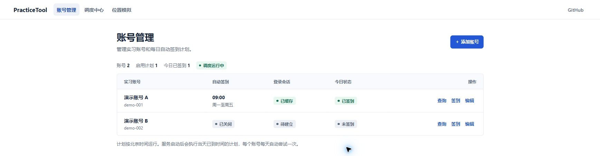
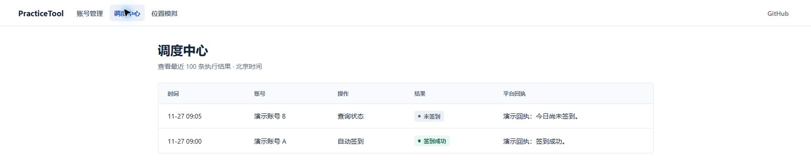
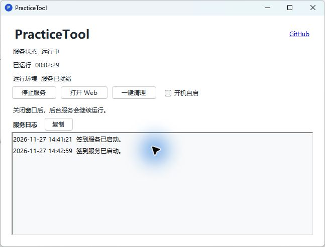

# PracticeTool

**岗位实习签到管理台**

在 Windows 上管理实习账号、查询当天的签到状态，并按北京时间安排现场签到。桌面启动器负责运行后台服务，浏览器用来管理账号和查看执行结果。

[下载启动器](https://github.com/fqy9242/GxzjsxsPracticeTool/releases) · [快速开始](#快速开始) · [邮件提醒](#邮件提醒) · [运行演示](#运行演示) · [常见问题](#常见问题)

> [!IMPORTANT]
> 本项目仅供学习和技术交流。请在学校、实习单位和平台允许的范围内使用。禁止用于非法用途、冒用他人账号或伪造签到记录。

## 功能特性

| 功能 | 能做什么 |
| --- | --- |
| 账号管理 | 管理多个已获授权的实习账号，查询当天状态、手动签到，按账号配置计划 |
| 定时签到 | 支持每天或周一至周五执行，可设置实习地点和核验范围 |
| 调度中心 | 查看最近 100 条执行结果和平台回执，定位失败时可查看原因 |
| 邮件提醒 | 可按账号选择是否接收手动和定时签到的结果 |
| Windows 启动器 | 启停后台服务、查看运行时长和日志，可选择登录 Windows 后自启 |
| 位置模拟 | 在浏览器里用测试坐标计算距离、判断范围，便于理解定位校验 |

## 快速开始

### 安装 Python 并配置 PATH

请先在 Windows 上从 [Python 官网](https://www.python.org/downloads/windows/) 安装 Python 3.9 或更新版本，并把 `python.exe` 所在目录加入用户的 `Path` 环境变量。使用带有 **Add python.exe to PATH** 选项的安装程序时，可在安装时直接勾选。

配置完成后重新打开 PowerShell，确认下面两条命令能找到刚安装的 Python。

```powershell
python --version
where.exe python
```

启动器会优先使用本机 Python。自动下载运行时可能失败，建议在启动程序前完成安装和 PATH 配置。

### Windows 启动器

1. **下载并运行启动器**。在 [GitHub Releases](https://github.com/fqy9242/GxzjsxsPracticeTool/releases) 下载 Windows 启动器，在 Windows 10 或 11 上双击 `PracticeTool.exe`，直接使用发布版。
2. **打开控制台**。点击 **启动服务**，等状态变为「运行中」后点击 **打开 Web**，进入[本地控制台](http://127.0.0.1:8765/)。
3. **添加账号**。在 **账号管理 → 添加账号** 填写显示名称、实习账号和密码。需要定时执行时，勾选 **启用自动签到** 并设置时间和频率。执行后到 **调度中心** 查看结果。

### 直接运行源码

完成 Python 安装和 PATH 配置后，在项目根目录运行以下命令，再打开[本地控制台](http://127.0.0.1:8765/)。Python 后端使用标准库。

```powershell
python -m practice_tool web
```

## 邮件提醒

1. 在 **账号管理 → 发件设置** 填写发件邮箱、SMTP 服务器、端口和授权码或密码。使用发件邮箱作为 SMTP 登录名，并按邮箱服务商的要求选择 SSL/TLS 或 STARTTLS。
2. 添加或编辑账号时，勾选 **启用邮件提醒** 并填写收件邮箱。新账号与现有账号默认关闭。
3. 手动或定时签到结束后，收件邮箱会收到签到成功、当天已签到或签到失败的结果。调度中心会显示邮件发送状态。

SMTP 授权码或密码使用当前 Windows 用户的 DPAPI 加密保存。

## 运行演示

以下是实际运行画面。账号、平台回执和执行记录来自独立测试环境中的演示数据。

### Web 控制台





<details>
<summary>查看 Windows 启动器和添加账号界面</summary>

| Windows 启动器 | 添加账号 |
| --- | --- |
|  |  |

</details>

## 签到计划与定位

- 计划按北京时间执行。服务启动时会检查当天已经到点的计划，每个账号每天自动尝试一次。
- 签到默认使用设备当前位置。选择 **指定实习地点** 时，填入 WGS-84 经纬度和范围。设备处于所设范围内后，按平台规则提交设备的实时位置。
- 手动和定时签到需要在实习地点使用 Windows 设备，并允许桌面应用访问系统定位。

## 命令行参数

| 命令 | 用途 |
| --- | --- |
| `python -m practice_tool web` | 启动本地 Web 控制台 |
| `python -m practice_tool login` | 验证实习账号能否登录 |
| `python -m practice_tool status` | 登录并查询当天签到状态 |
| `python -m practice_tool check-in` | 使用 Windows 现场定位执行一次签到 |
| `python -m practice_tool check-in --at 09:00 --weekdays-only` | 在北京时间 09:00 执行，限周一至周五 |

| 命令 | 参数 | 说明 |
| --- | --- | --- |
| `web` | `--host HOST` | 监听地址，默认 `127.0.0.1` |
| `web` | `--port PORT` | 监听端口，默认 `8765` |
| `web` | `--data-dir PATH` | 指定数据目录，可用于隔离测试数据 |
| `web` | `--cert CERT`、`--key KEY` | 配置 HTTPS 证书和私钥，两个参数一起使用 |
| `check-in` | `--at HH:MM` | 每天在指定的北京时间执行，需要保持命令运行 |
| `check-in` | `--weekdays-only` | 仅周一至周五执行，和 `--at` 一起使用 |

`login`、`status` 和 `check-in` 默认交互式读取账号与密码，也支持从当前进程的 `PRACTICE_USERNAME` 和 `PRACTICE_PASSWORD` 读取。各命令支持 `--help`。

## 常见问题

**关闭启动器以后，计划还会执行吗？**

会。图形窗口关闭后，后台服务继续运行。重新打开启动器可查看同一服务的运行时长和日志。需要结束运行时，点击 **停止服务**。

**怎样让服务在开机后自动运行？**

在启动器中勾选 **开机自启**。该选项默认关闭，启用后会在当前用户登录 Windows 时启动后台服务。移动 EXE 后，将选项关闭再开启即可更新启动路径。

**控制台打不开怎么办？**

先看启动器是否显示「运行中」。若日志显示端口已占用，检查 `8765` 是否由另一个实例使用。

**签到时获取不到位置怎么办？**

在 Windows 设置中检查定位服务和桌面应用定位权限，再到 **调度中心** 查看该次执行结果。

**数据保存在哪里？**

默认目录为 `%LOCALAPPDATA%\PracticeTool`。账号、计划和记录保存在 `practice.sqlite3` 中，密码和会话凭据使用当前 Windows 用户的 DPAPI 加密。启动器日志位于 `launcher-runtime\service`。

> [!CAUTION]
> **一键清理**会停止服务、关闭开机自启，并删除本机账号、会话、计划、执行记录和应用专用运行时。

## 开发者构建

在 Windows 上克隆仓库，然后在项目根目录运行构建脚本。构建使用 Windows .NET Framework 自带的 C# 编译器。

```powershell
git clone https://github.com/fqy9242/GxzjsxsPracticeTool.git
cd GxzjsxsPracticeTool
.\tools\build-launcher.ps1
```

生成文件为 `dist\launcher\PracticeTool.exe`，包含 Python 后端和 Web 静态资源。

[提交问题或建议](https://github.com/fqy9242/GxzjsxsPracticeTool/issues)
