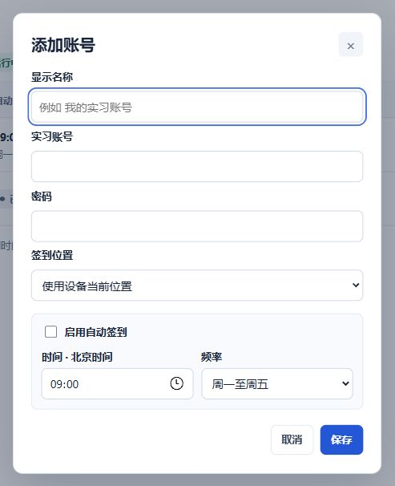

# PracticeTool

> [!IMPORTANT]
> 本项目仅供学习和技术交流。请在学校、实习单位和平台允许的范围内使用。禁止用于非法用途、冒用他人账号或伪造签到记录。

支持 Windows 桌面启动器与 Linux Docker Compose 部署，提供多账号签到、日期规则配置、随机时间调度和邮件通知。

[下载发布版](https://github.com/fqy9242/GxzjsxsPracticeTool/releases) · [快速开始](#快速开始) · [Linux 部署](#linux-docker-compose-部署) · [使用说明](#使用说明) · [界面预览](#界面预览) · [常见问题](#常见问题) · [问题反馈](https://github.com/fqy9242/GxzjsxsPracticeTool/issues)

## 功能特性

| 功能 | 说明 |
| --- | --- |
| 多账号管理 | 添加、编辑和删除实习账号，分别配置签到计划与邮件通知 |
| 签到与查询 | 查询当日签到状态，并通过平台接口提交手动签到请求 |
| 定时签到 | 按北京时间执行，支持每天、星期、工作日、节假日等六种日期规则 |
| 随机时间 | 支持指定当天时间段，每日生成并持久化执行时间，重启后保持不变 |
| Linux 部署 | 提供 Dockerfile、Docker Compose、数据持久化、健康检查及管理台认证 |
| 位置配置 | 支持设备当前位置与自定义位置，可按账号分别设置 |
| 执行记录 | 展示最近 100 条执行记录、平台回执及邮件发送状态 |
| 邮件通知 | 通过 SMTP 发送签到成功、当日已签到或执行失败的结果 |
| 桌面启动器 | 启停后台服务、查看运行日志，并配置当前用户登录 Windows 后自动启动 |
| 凭据保护 | Windows 使用 DPAPI，Linux 使用持久化密钥加密账号密码、登录会话及 SMTP 密码 |

## 运行环境

| 项目 | 要求 |
| --- | --- |
| 操作系统 | Windows 10/11；Linux 支持 Docker Compose 或源码运行 |
| Python | Python 3.9 及以上版本；启动器优先使用本机 Python |
| 浏览器 | 支持现代 Web 标准的浏览器，用于访问本地控制台 |
| 网络 | 能够访问实习平台；启用邮件通知时，还需能够连接相应 SMTP 服务器 |
| 定位权限 | 使用设备当前位置或执行定位检测时，需开启 Windows 定位服务及桌面应用定位权限 |

Windows 后端无需额外安装第三方 Python 依赖；Linux 凭据加密使用 `cryptography`，Docker 镜像自动安装。自定义位置模式使用已保存的坐标提交签到，无需读取本机定位。

## 快速开始

### 1. 安装并检查 Python 环境

从 [Python 官网](https://www.python.org/downloads/windows/) 安装 Python 3.9 或更高版本，并将 `python.exe` 所在目录加入用户的 `Path` 环境变量。

安装完成后，重新打开 PowerShell 并执行：

```powershell
python --version
where.exe python
```

确认版本符合要求，且命令能够找到对应的 Python 可执行文件。启动器在未找到可用本机 Python 时会尝试下载专用运行时；若下载失败，可安装本机 Python 并完成上述配置后重试。

### 2. 启动服务（Windows）

1. 从 [GitHub Releases](https://github.com/fqy9242/GxzjsxsPracticeTool/releases) 下载 Windows 启动器 `PracticeTool.exe`。
2. 运行启动器，单击 **启动服务**。
3. 服务状态显示为“运行中”后，单击 **打开 Web**，或访问 [本地控制台](http://127.0.0.1:8765/)。

默认控制台地址为 `http://127.0.0.1:8765/`。

### 3. 配置账号

1. 在 **账号管理** 页面单击 **添加账号**，填写显示名称、实习账号和密码。
2. 选择签到位置；使用自定义位置时，填写相应坐标并保存。
3. 如需定时执行，勾选 **启用自动签到**，设置执行时间和频率。
4. 保存后，可通过 **查询** 核对当日状态，或通过 **签到** 发起手动签到。
5. 在 **调度中心** 查看执行结果和平台回执。

### 从源码运行

在安装 Python 后，通过以下命令获取并运行项目：

```bash
git clone https://github.com/fqy9242/GxzjsxsPracticeTool.git
cd GxzjsxsPracticeTool
python -m pip install -r requirements.txt
python -m practice_tool web
```

启动后访问 [本地控制台](http://127.0.0.1:8765/)。使用此方式运行时，需保持终端中的服务进程运行。

## Linux Docker Compose 部署

Linux 主机需安装 Docker Engine 和 Docker Compose v2。在本项目根目录执行：

```bash
cp .env.example .env
# 编辑 .env，将 PRACTICE_ADMIN_PASSWORD 设置为至少 12 个字符的管理台密码
docker compose up -d --build
docker compose ps
```

默认仅发布至服务器的 `127.0.0.1:8765`。在服务器本机访问该地址，或在自己的电脑建立 SSH 转发后访问 [本地控制台](http://127.0.0.1:8765/)：

```bash
ssh -N -L 8765:127.0.0.1:8765 user@server
```

浏览器弹出登录框后，输入管理用户名（默认 `admin`）及 `.env` 中设置的密码。管理台凭据与实习平台账号相互独立。Linux 不提供 Windows 设备定位，添加签到账号时应选择 **自定义位置**。

SQLite 数据库、凭据密钥和每日随机时间保存在 `practice-data` 命名卷中，容器重建后继续保留。常用维护命令如下：

```bash
docker compose logs -f --tail=100
docker compose up -d --build   # 更新代码后重新构建并启动
docker compose down          # 停止并移除容器，保留命名卷
```

需要通过域名访问时，可配置 HTTPS 反向代理及 `PRACTICE_PUBLIC_ORIGIN`。完整配置、数据备份及节假日日历维护见 [Linux 部署说明](docs/deployment.md)。

## 使用说明

### 签到位置

在账号编辑页面的 **签到位置** 中选择位置来源。保存后的配置同时适用于该账号的手动签到和定时签到。

| 模式 | 提交位置的来源 | 是否读取本机定位 |
| --- | --- | --- |
| 使用设备当前位置 | 签到执行时获取的 Windows 设备坐标 | 是 |
| 自定义位置 | 该账号已保存的自定义经纬度 | 否 |

**自定义位置的配置与提交规则：**

- 坐标采用 WGS-84，纬度与经度应分别填写，避免颠倒顺序。
- 保存后，签到请求使用填写的坐标，并按平台要求转换为 GCJ-02 坐标后提交。
- 本机位置与自定义位置之间的距离不影响坐标选择；平台设置的签到范围规则仍然适用。
- **参考范围**仅用于定位检测时比较设备与自定义位置的距离，不作为自定义位置提交的限制条件。
- 切换回 **使用设备当前位置** 并保存后，后续签到恢复使用本机定位。

如需读取设备坐标，可在自定义位置配置区域单击 **检测当前位置**，查看 Windows 返回的经纬度、定位精度和距参考点的距离。单击 **用当前位置填入** 可将检测结果写入坐标输入框，保存账号后生效。定位检测本身不会提交签到。

### 定时签到

- 所有签到计划均按**北京时间（UTC+8）**执行。
- 每个账号每天最多自动尝试一次。执行失败后不会在当天重复自动提交，可根据执行记录排查后手动处理。
- 电脑需保持开机，后台服务需持续运行。休眠、关机或停止服务期间无法执行计划。

**执行日期：**

| 选项 | 日期规则 |
| --- | --- |
| 每天 | 每个自然日执行 |
| 周一至周五 | 仅按星期判断，不处理节假日和调休 |
| 仅周末 | 每周六、周日执行，不处理调休 |
| 仅工作日（含调休） | 排除公布的放假日期，包含调休上班日期 |
| 仅节假日（不含普通周末） | 仅在公布的节假日放假区间执行，包含假期内的周末和调休日 |
| 节假日和周末（排除调休上班） | 在公布的放假日期及普通周末执行，排除调休上班日期 |

内置 2026、2027 年中国大陆放假调休日历，依据国务院办公厅公布的年度安排。未覆盖的年份会显示错误并暂停依赖日历的自动任务，不会按普通周末规则推测。可通过数据目录中的 `calendar.json` 补充或更新日历，详见 [日历维护](docs/deployment.md#节假日日历)。

**执行时间：**

| 选项 | 执行规则 |
| --- | --- |
| 固定时间 | 到达设定时间后执行；当天启动较晚时，会检查并执行尚未自动尝试的到期计划 |
| 时间段内随机 | 在当天开始和结束时间之间按分钟生成执行时间，时间段必须位于同一天且结束时间晚于开始时间 |

随机时间按账号和日期保存在数据库中，控制台显示“今日计划”。刷新页面或重启服务不会重新抽取；有多个可选分钟时，会避开上一个执行日的计划时间。若首次配置或启动已处于时间段内，只从剩余时间中选择；若已错过整个时间段，当天不再自动补签。日期规则与随机时间可组合使用，例如“仅节假日 + 09:00–10:30 随机”。

关闭 Web 页面或 Windows 启动器窗口后，后台服务仍会继续运行。需要停止任务调度时，应在启动器中单击 **停止服务**；Docker 部署使用 `docker compose stop`。

### 邮件通知

邮件通知由全局发件配置与账号收件配置两部分组成。

1. 在 **账号管理 → 发件设置** 中填写发件邮箱、SMTP 服务器、端口及授权码或密码。SMTP 登录名使用发件邮箱地址，加密方式按邮箱服务商要求选择 **SSL/TLS** 或 **STARTTLS**。
2. 添加或编辑账号时，勾选 **启用邮件提醒**，填写收件邮箱并保存。邮件提醒默认关闭。
3. 手动或定时签到结束后，系统发送相应结果，并在 **调度中心** 显示邮件发送状态。单独查询签到状态不发送邮件。

SMTP 授权码或密码使用当前平台的凭据保护机制加密保存。邮件发送失败时，可先查看签到执行结果，再检查发件设置、网络连接及邮箱服务商的 SMTP 访问要求。

### 登录后自动启动

在启动器中勾选 **开机自启**，可在当前用户登录 Windows 后自动启动后台服务。此选项默认关闭。

移动启动器文件后，应关闭再重新开启该选项，以更新启动路径。

### 更新版本

1. 在旧启动器中单击 **停止服务**，等待服务停止后退出启动器。
2. 使用新版本替换原启动器文件。
3. 运行新版本，单击 **启动服务**，并重新打开或刷新 Web 控制台。

使用同一 Windows 用户和默认数据目录时，更新启动器可继续使用已有账号、配置和记录。更新版本无需执行 **一键清理**。

## 界面预览


### 账号管理


### 调度中心


<details>
<summary>查看桌面启动器与账号配置界面</summary>

| Windows 启动器 | 账号配置 |
| --- | --- |
|  |  |

</details>

## 命令行参考

### 常用命令

| 命令 | 说明 |
| --- | --- |
| `python -m practice_tool web` | 启动 Web 控制台及账号任务调度服务 |
| `python -m practice_tool login` | 验证账号能否登录实习平台 |
| `python -m practice_tool status` | 登录并查询当日签到状态 |
| `python -m practice_tool check-in` | 使用 Windows 设备当前位置执行一次签到 |
| `python -m practice_tool check-in --at 09:00 --weekdays-only` | 按北京时间在周一至周五每日 09:00 执行签到 |

`login`、`status` 和 `check-in` 默认通过终端交互读取账号及密码，也支持从当前进程的 `PRACTICE_USERNAME` 和 `PRACTICE_PASSWORD` 环境变量读取。

命令行 `check-in` 使用设备当前位置，不读取 Web 控制台中保存的账号和自定义位置配置。需要按账号使用自定义位置时，请通过 Web 控制台配置并执行。

### 可选参数

| 命令 | 参数 | 说明 |
| --- | --- | --- |
| `web` | `--host HOST` | 监听地址，默认 `127.0.0.1` |
| `web` | `--port PORT` | 监听端口，默认 `8765` |
| `web` | `--data-dir PATH` | 指定账号、计划及记录的数据目录 |
| `web` | `--server` | 启用需要管理台用户名和密码的服务器模式，适用于 Linux/Docker |
| `web` | `--cert CERT`、`--key KEY` | HTTPS 证书和私钥，必须同时提供 |
| `check-in` | `--at HH:MM` | 每日在指定的北京时间执行，需保持进程运行 |
| `check-in` | `--weekdays-only` | 仅周一至周五执行，必须与 `--at` 配合使用 |

默认桌面模式仅允许本机管理账号。服务器模式通过管理台认证开放账号管理，Docker 配置默认绑定宿主机回环地址；经 HTTPS 反向代理访问时应配置准确的站点源。命令行独立 `check-in` 仍使用设备定位，六种日期规则及随机时间通过账号管理台配置。

各命令均支持 `--help`，例如：

```powershell
python -m practice_tool --help
python -m practice_tool web --help
```

## 数据与凭据

Windows 默认数据目录为 `%LOCALAPPDATA%\PracticeTool`，Linux 源码模式默认为 `~/.local/share/PracticeTool`，Docker 模式为 `/data`。可通过 `--data-dir` 或 `PRACTICE_DATA_DIR` 指定目录。

| 路径 | 内容 |
| --- | --- |
| `practice.sqlite3` | 账号配置、签到计划、执行记录及邮件设置 |
| `secret.key` | Linux 凭据加密密钥，首次启动时生成，需与数据库一并备份 |
| `calendar.json` | 可选的年度节假日和调休日期配置 |
| `launcher-runtime\service\service.log` | 后台服务运行日志 |
| `launcher-runtime` | 启动器管理的应用文件、服务控制文件及专用运行时（如已下载） |

Windows 凭据使用当前用户的 DPAPI 加密；Linux 凭据使用 Fernet 加密，密钥保存在权限为 `0600` 的 `secret.key` 中。两种凭据格式不互通，直接复制 Windows 数据库到 Linux 后，需要重新填写账号和 SMTP 密码。迁移 Linux 部署时须同时保留数据库和原密钥。

**一键清理**会停止后台服务、关闭开机自启，并删除本机账号、配置、执行记录及应用专用运行时。清理前应确认相关数据不再需要。

## 常见问题

### 无法打开 Web 控制台

确认启动器中的服务状态为“运行中”，并使用服务对应的地址访问。若启动日志提示端口被占用，请检查 `8765` 端口是否已有其他服务或 PracticeTool 实例使用。

### 无法获取设备位置

检查 Windows 定位服务及桌面应用定位权限，并查看 **调度中心** 中的具体错误。该要求适用于设备当前位置模式和定位检测；自定义位置模式提交签到时不读取本机定位。

### 自定义位置提交后仍提示超出范围

检查输入坐标是否为 WGS-84、经纬度是否填写正确，以及该位置是否符合平台配置的签到范围。页面中的参考范围仅用于定位检测，不会修改平台的范围设置。

### 定时任务未按预期执行

依次检查后台服务是否运行、账号是否启用自动签到、执行时间是否为北京时间，以及执行频率是否包含当天。当天已经自动尝试过的账号不会重复自动执行，可在 **调度中心** 查看记录。

随机模式还需确认当前时间仍在设定时段内。仅工作日或节假日模式出现“缺少年度日历”提示时，应补充相应日历后重启服务。

### 更新后仍显示旧界面或旧行为

确认旧后台服务已停止，使用新启动器重新启动服务后，再刷新浏览器页面。仅关闭浏览器或启动器窗口不会停止原后台服务。

## 开发与构建

执行离线回归测试：

```bash
python -m pip install -r requirements.txt
python -m unittest discover -s tests -v
```

Docker 镜像可通过 `docker compose build` 构建，配置可通过 `docker compose config --quiet` 检查。

在 Windows 上安装 Git 并克隆项目：

```powershell
git clone https://github.com/fqy9242/GxzjsxsPracticeTool.git
cd GxzjsxsPracticeTool
```

在项目根目录运行构建脚本：

```powershell
.\tools\build-launcher.ps1
```

构建脚本使用 Windows .NET Framework 提供的 C# 编译器。生成文件位于 `dist\launcher\PracticeTool.exe`，其中包含 Python 后端及 Web 静态资源。

## 使用与反馈

请仅管理本人或已获授权的账号，并遵守学校、实习单位及相关平台的管理规定，确保所提交的信息真实、准确。本项目用于学习与技术交流。

如需报告问题或提出建议，请通过 [GitHub Issues](https://github.com/fqy9242/GxzjsxsPracticeTool/issues) 提交，并附上程序版本、运行环境、复现步骤和相关错误日志。提交日志或截图前，请移除账号密码、会话令牌及 SMTP 授权码等敏感信息。
